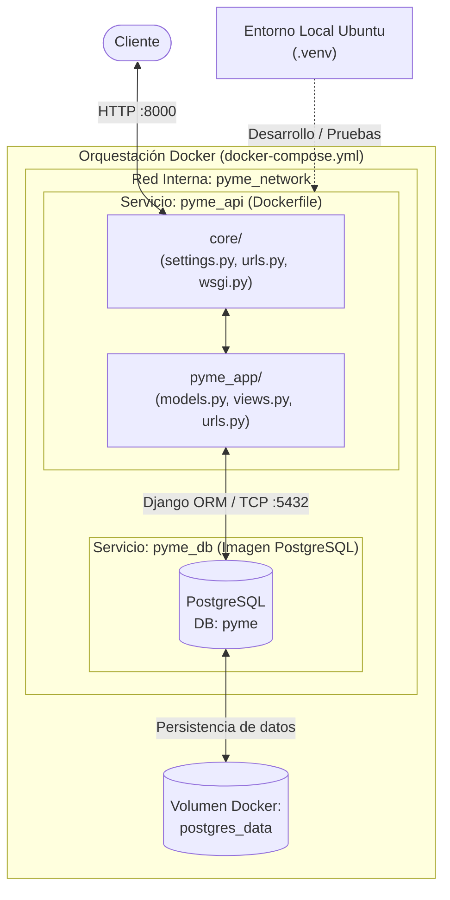

# TP EVI — Backend API + Base de datos + Admin Web (Django + PostgreSQL)

Aplicación web/API desarrollada con **Django** y **PostgreSQL** para la gestión de tareas, con soporte para administración desde Django Admin y exportación de registros a CSV.

## Tecnologías principales
- **Backend:** Python 3 / Django
- **Base de datos:** PostgreSQL 16 (`postgres:16-alpine`)
- **Contenedores:** Docker & Docker Compose

## Estructura del proyecto

```text
tp_evi/
├── core/                 # Configuración principal de Django (settings, urls, wsgi)
├── pyme_app/             # Aplicación principal (modelos, vistas, admin, lógica de tareas)
├── manage.py             # Utilidad CLI de Django
├── requirements.txt      # Dependencias de Python
├── Dockerfile            # Imagen del servicio Django (api)
└── docker-compose.yml    # Orquestación de servicios (api + db)
```
## Instalación de Docker
### Requisitos previos
Docker y Docker Compose instalados en el entorno.

Clonar el repositorio e ingresar al proyecto
```git clone <URL_DEL_REPOSITORIO>
cd tp_evi
```

Construir y levantar los contenedores
```
docker compose up -d --build
```

Esto iniciará dos servicios en la red interna pyme_network:

pyme_db: PostgreSQL 16 (base pyme).

pyme_api: Servidor Django escuchando en 0.0.0.0:8000.

Aplicar migraciones y crear superusuario:

```
docker compose exec api python manage.py migrate
```

```
docker compose exec api python manage.py createsuperuser
```

## Acceso a la aplicación

Aplicación / API: http://<IP_DEL_SERVIDOR>:8000/

Panel de administración: http://<IP_DEL_SERVIDOR>:8000/admin/

## Variables de entorno

El servicio api toma la configuración de base de datos desde el entorno (con valores por defecto en core/settings.py)

DB_NAME: Nombre de la base de datos PostgreSQL

DB_USER: Usuario de la base de datos

DB_PASSWORD: Contraseña de la base de datos

DB_HOST: Host de la base de datos

## Desarrollo local con entorno virtual (venv)

```
python3 -m venv .venv
```

```
source .venv/bin/activate
```

```
pip install --upgrade pip
```

```
pip install -r requirements.txt
```

### Aplicar los modelos de la base de datos

#### Crear los archivos de migración

```
python3 manage.py makemigrations
```

#### Aplicar las migraciones

```
python3 manage.py migrate
```

### Ejecutar la aplicación

```
python3 manage.py runserver
```

### Acceder a la aplicación en el navegador

Entrar en <b>localhost:8000/admin</b> para acceder a la base de datos y descargar reportes.

### Ver estado de los contenedores

```
docker compose ps
```

### Ver logs del servidor Django

```
docker compose logs -f api
```

### Detener los servicios

```
docker compose down
```

## Diagrama de arquitectura

